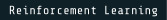
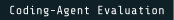
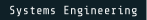

<!-- Hosted visuals: capsule-render (dividers), skillicons.dev (tech icons), Google Noto animated emoji (stickers).
    Local visuals: assets/type/ = text + badges pre-rendered as SVG outlines in Ithaca / Orbitron / Oxanium / Share Tech Mono
     (GitHub READMEs cannot load web fonts). Rebuild with: python tools/build_type.py -->

  <picture><source media="(prefers-color-scheme: dark)" srcset="assets/type/dark/greeting.svg"></picture>
  

  
  
  
  

I'm a B.Tech CSE student and RL Research Intern at Wootzapp, interested in reinforcement learning, LLM post-training, and the evaluation of intelligent systems.

I build systems and run controlled experiments to understand how agents learn from rewards, execution feedback, and imperfect models. My work spans RL research, coding-model evaluation, systems engineering, and open-source software.

##  <picture><source media="(prefers-color-scheme: dark)" srcset="assets/type/dark/h_stats.svg"></picture>

  

<!-- LIVE-STATS:START -->

🟢 **Status:** Online — last synced Wed, 11 Nov 2026 04:00:16 GMT

📌 **Latest public activity:** `Solve logistic\-regression\-training` in `HimanshuPathak2725/TensorTonic\-Solutions` (14 hours ago)

📦 **Public repos:** 101   👥 **Followers:** 32

_This section refreshes automatically via GitHub Actions every 6 hours._

<!-- LIVE-STATS:END -->

##  <picture><source media="(prefers-color-scheme: dark)" srcset="assets/type/dark/h_work.svg"></picture>

A few personal projects I've built, separate from my research work.

<table>
  <tr>
    <td width="33%" valign="top">
      <h4> <a href="https://github.com/HimanshuPathak2725/let-execution-do-the-teaching"><picture><source media="(prefers-color-scheme: dark)" srcset="assets/type/dark/c_exec.svg"></picture></a></h4>
      
Research and evaluation work on coding-model post-training, including supervised fine-tuning, GRPO, execution-based verification, and multi-turn feedback. The repository contains evaluation artifacts, verifier implementations, and experiments comparing training approaches using executable tests and task-level evidence.

      <picture><source media="(prefers-color-scheme: dark)" srcset="assets/type/dark/s_exec.svg"></picture>
    </td>
    <td width="33%" valign="top">
      <h4> <a href="https://github.com/HimanshuPathak2725/VaporWall"><picture><source media="(prefers-color-scheme: dark)" srcset="assets/type/dark/c_vapor.svg"></picture></a></h4>
      
A systems-security project exploring network filtering and threat analysis with Rust and eBPF/XDP. Its architecture combines kernel-level packet filtering with asynchronous user-space inspection, TCP stream reassembly, signature matching, and ONNX-based threat classification.

       
      <picture><source media="(prefers-color-scheme: dark)" srcset="assets/type/dark/s_vapor.svg"></picture>
    </td>
    <td width="33%" valign="top">
      <h4> <a href="https://github.com/HimanshuPathak2725/Real_Time_Fraud_Detection_System"><picture><source media="(prefers-color-scheme: dark)" srcset="assets/type/dark/c_fraud.svg"></picture></a></h4>
      
A real-time fraud-scoring prototype built with Python, Isolation Forest, FastAPI, and Kafka. It uses synthetic transaction data to explore anomaly scoring, event processing, and live WebSocket monitoring. This is a learning and portfolio project, not a production fraud-detection system.

      
    </td>
  </tr>
</table>

##  <picture><source media="(prefers-color-scheme: dark)" srcset="assets/type/dark/h_research.svg"></picture>

I use small, inspectable experiments to investigate learning dynamics, reward design, uncertainty, and model-based decision-making.

<picture><source media="(prefers-color-scheme: dark)" srcset="assets/type/dark/sum_research.svg"></picture>

- <a href="https://himanshupathak.is-a.dev/posts/policy-gradients-and-the-meaning-of-credit/"><picture><source media="(prefers-color-scheme: dark)" srcset="assets/type/dark/r_policy.svg"></picture></a> — An experiment on stochastic policy-gradient updates, baselines, and the difference between an unbiased estimator and the outcome of an individual update.

- <a href="https://himanshupathak.is-a.dev/posts/reward-shaping-without-changing-the-task/"><picture><source media="(prefers-color-scheme: dark)" srcset="assets/type/dark/r_reward.svg"></picture></a> — A controlled Q-learning experiment exploring how potential-based reward shaping can preserve returns while changing the learning trajectory.

- <a href="https://himanshupathak.is-a.dev/posts/what-uncertainty-can-tell-a-planner/"><picture><source media="(prefers-color-scheme: dark)" srcset="assets/type/dark/r_uncert.svg"></picture></a> — An investigation into model misspecification, predictive uncertainty, extrapolation, and the value of collecting informative observations.

- <a href="https://himanshupathak.is-a.dev/posts/the-world-models-today/"><picture><source media="(prefers-color-scheme: dark)" srcset="assets/type/dark/r_world.svg"></picture></a> — An interactive guide to latent dynamics, partial observability, planning, and evaluating predictions through their consequences for decisions.

##  <picture><source media="(prefers-color-scheme: dark)" srcset="assets/type/dark/h_skills.svg"></picture>

<table>
  <tr>
    <td><picture><source media="(prefers-color-scheme: dark)" srcset="assets/type/dark/lbl_ml.svg"></picture></td>
    <td>
       
      <picture><source media="(prefers-color-scheme: dark)" srcset="assets/type/dark/s_ml.svg"></picture>
    </td>
  </tr>
  <tr>
    <td><picture><source media="(prefers-color-scheme: dark)" srcset="assets/type/dark/lbl_lang.svg"></picture></td>
    <td></td>
  </tr>
  <tr>
    <td><picture><source media="(prefers-color-scheme: dark)" srcset="assets/type/dark/lbl_be.svg"></picture></td>
    <td>
       
      <picture><source media="(prefers-color-scheme: dark)" srcset="assets/type/dark/s_be.svg"></picture>
    </td>
  </tr>
  <tr>
    <td><picture><source media="(prefers-color-scheme: dark)" srcset="assets/type/dark/lbl_web.svg"></picture></td>
    <td></td>
  </tr>
</table>

##  <picture><source media="(prefers-color-scheme: dark)" srcset="assets/type/dark/h_oss.svg"></picture>

My open-source work includes core Go engineering, WebSocket security, backend authorization, AI input hardening, distributed-system reliability, resource management, and developer tooling.

<picture><source media="(prefers-color-scheme: dark)" srcset="assets/type/dark/sum_gg.svg"></picture>

Contributed core Go changes to a collaborative remote-terminal relay.

- <a href="https://github.com/VishalRaut2106/go-gatekeeper/pull/8"><picture><source media="(prefers-color-scheme: dark)" srcset="assets/type/dark/gg8.svg"></picture></a> · Merged  
  Fixed a blocked `readPump` during room destruction using a room-level completion channel and synchronized closure. Added a regression test for the host-disconnect scenario with a connected guest.

- <a href="https://github.com/VishalRaut2106/go-gatekeeper/pull/9"><picture><source media="(prefers-color-scheme: dark)" srcset="assets/type/dark/gg9.svg"></picture></a> · Merged  
  Added rate limiting before WebSocket upgrades to restrict excessive connection attempts.

- <a href="https://github.com/VishalRaut2106/go-gatekeeper/pull/17"><picture><source media="(prefers-color-scheme: dark)" srcset="assets/type/dark/gg17.svg"></picture></a> · Merged  
  Added an Origin allowlist to strengthen the WebSocket security boundary.

- <a href="https://github.com/VishalRaut2106/go-gatekeeper/pull/20"><picture><source media="(prefers-color-scheme: dark)" srcset="assets/type/dark/gg20.svg"></picture></a> · Merged  
  Removed session codes from the unauthenticated statistics endpoint and increased generated code length from six to ten hexadecimal characters.

- <a href="https://github.com/VishalRaut2106/go-gatekeeper/pull/30"><picture><source media="(prefers-color-scheme: dark)" srcset="assets/type/dark/gg30.svg"></picture></a> · Merged  
  Added a 32 KiB message-size limit, read/write deadlines, and ping/pong handling to improve resource control and connection lifecycle management.

- <a href="https://github.com/VishalRaut2106/go-gatekeeper/pull/18"><picture><source media="(prefers-color-scheme: dark)" srcset="assets/type/dark/gg18.svg"></picture></a> · Merged  
  Added signal-aware shutdown handling for `SIGTERM` and `SIGINT`.

- <a href="https://github.com/VishalRaut2106/go-gatekeeper/pull/19"><picture><source media="(prefers-color-scheme: dark)" srcset="assets/type/dark/gg19.svg"></picture></a> · Merged  
  Added checksum generation and verification to strengthen downloaded-binary integrity.

<picture><source media="(prefers-color-scheme: dark)" srcset="assets/type/dark/sum_mf.svg"></picture>

- <a href="https://github.com/Nebulyn-Labs/MediFlow/pull/443"><picture><source media="(prefers-color-scheme: dark)" srcset="assets/type/dark/mf443.svg"></picture></a> · Merged  
  Added prompt-hardening utilities across Node.js and Dart, sanitized user-controlled input before delimiting it, and introduced automated tests for delimiter spoofing and instruction-override attempts.

- <a href="https://github.com/Nebulyn-Labs/MediFlow/pull/394"><picture><source media="(prefers-color-scheme: dark)" srcset="assets/type/dark/mf394.svg"></picture></a> · Merged  
  Strengthened facility ownership validation to prevent users from registering themselves against another facility.

- <a href="https://github.com/Nebulyn-Labs/MediFlow/pull/445"><picture><source media="(prefers-color-scheme: dark)" srcset="assets/type/dark/mf445.svg"></picture></a> · Merged  
  Separated expected business-rule failures from transient infrastructure errors so retryable failures are not incorrectly treated as permanent rejections.

- <a href="https://github.com/Nebulyn-Labs/MediFlow/pull/96"><picture><source media="(prefers-color-scheme: dark)" srcset="assets/type/dark/mf96.svg"></picture></a> · Merged  
  Introduced reusable server-side rate limiting to reduce endpoint abuse and excessive AI inference costs.

<picture><source media="(prefers-color-scheme: dark)" srcset="assets/type/dark/sum_yh.svg"></picture>

- <a href="https://github.com/uditt490-pixel/YuvaHub/pull/619"><picture><source media="(prefers-color-scheme: dark)" srcset="assets/type/dark/yh619.svg"></picture></a> · Merged  
  Tightened Firestore access controls, added ownership checks for events and groups, and introduced 33 automated security-rule tests.

- <a href="https://github.com/uditt490-pixel/YuvaHub/pull/565"><picture><source media="(prefers-color-scheme: dark)" srcset="assets/type/dark/yh565.svg"></picture></a> · Merged  
  Improved message-delivery observability with publisher confirmations, bounded retries, dead-letter routing, and regression tests.

- <a href="https://github.com/uditt490-pixel/YuvaHub/pull/562"><picture><source media="(prefers-color-scheme: dark)" srcset="assets/type/dark/yh562.svg"></picture></a> · Merged  
  Added bounded cache eviction and recovery from browser storage quota errors while preserving the existing two-tier cache design.

<picture><source media="(prefers-color-scheme: dark)" srcset="assets/type/dark/sum_dt.svg"></picture>

- <a href="https://github.com/Aharshi3614/Devwhisper/pull/173"><picture><source media="(prefers-color-scheme: dark)" srcset="assets/type/dark/dw173.svg"></picture></a> · Merged  
  Introduced Python AST-based extraction of functions, classes, and methods as discrete indexing units. Combined symbol-level and line-based chunks, enriched retrieval metadata, and added tests. The PR reports 80 passing tests, including 18 new tests.

- <a href="https://github.com/Aryan0628/diffguardian/pull/19"><picture><source media="(prefers-color-scheme: dark)" srcset="assets/type/dark/dg19.svg"></picture></a> · Merged  
  Added `--scope` support to limit trace results to a directory or package, including path normalization and filtering during recursive barrel traversal.

- <a href="https://github.com/Aryan0628/diffguardian/pull/16"><picture><source media="(prefers-color-scheme: dark)" srcset="assets/type/dark/dg16.svg"></picture></a> · Merged  
  Added structured JSON output for trace results, making the CLI easier to integrate into automated workflows.

- <a href="https://github.com/ZarrarPeshimam/RepoStart/pull/37"><picture><source media="(prefers-color-scheme: dark)" srcset="assets/type/dark/rs37.svg"></picture></a> · Merged  
  Added fallback detection through common Python entry-point files when dependency manifests are absent, while preserving information about how a project was detected.

<picture><source media="(prefers-color-scheme: dark)" srcset="assets/type/dark/sum_sr.svg"></picture>

- <a href="https://github.com/Ganesh-403/semantic-plagiarism-detector/pull/1695"><picture><source media="(prefers-color-scheme: dark)" srcset="assets/type/dark/sp1695.svg"></picture></a> · Merged  
  Added DNS-pinning support to the SSRF protection layer, using the validated IP for requests while preserving the hostname and supporting IPv6. Included six focused security tests.

- <a href="https://github.com/Ganesh-403/semantic-plagiarism-detector/pull/1697"><picture><source media="(prefers-color-scheme: dark)" srcset="assets/type/dark/sp1697.svg"></picture></a> · Merged  
  Added stress testing for SQLite connection behavior under concurrent access.

- <a href="https://github.com/SatyamPandey-07/WorkSphere/pull/2138"><picture><source media="(prefers-color-scheme: dark)" srcset="assets/type/dark/ws2138.svg"></picture></a> · Merged  
  Added explicit WASM heap cleanup, worker lifecycle handling, and a memory-retention test covering 50 consecutive verifications.

- <a href="https://github.com/Canopus-Labs/PrepPilot/pull/306"><picture><source media="(prefers-color-scheme: dark)" srcset="assets/type/dark/pp306.svg"></picture></a> · Merged  
  Added URL parsing and HTTPS validation, restricted redirects to an allowlisted download host, and introduced regression tests for unsafe redirect targets.

##  <picture><source media="(prefers-color-scheme: dark)" srcset="assets/type/dark/h_interests.svg"></picture>

  
  
  
  
  
  
  

  More about my work and experiments: <a href="https://himanshupathak.is-a.dev/">himanshupathak.is-a.dev</a>

